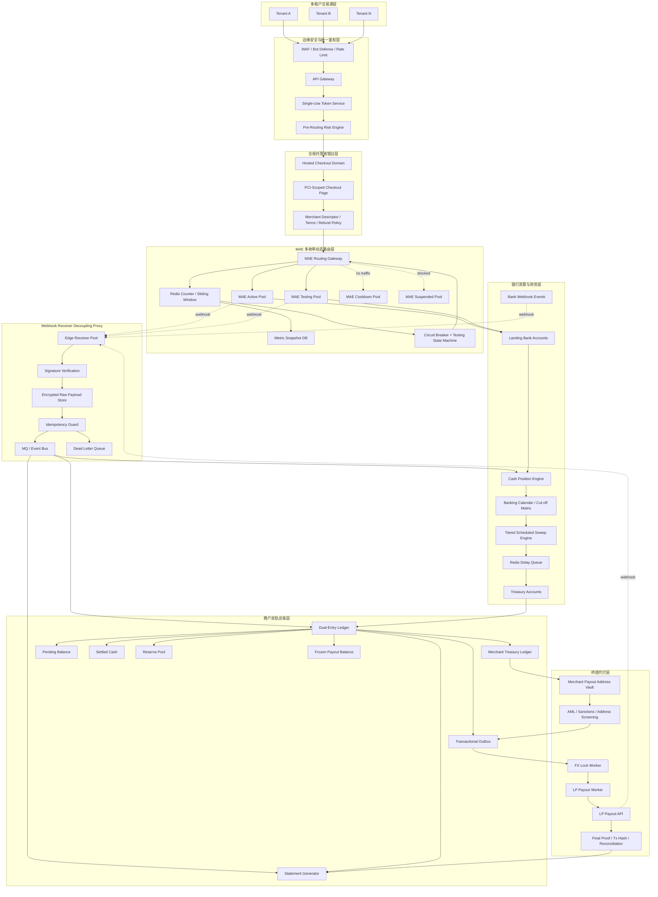
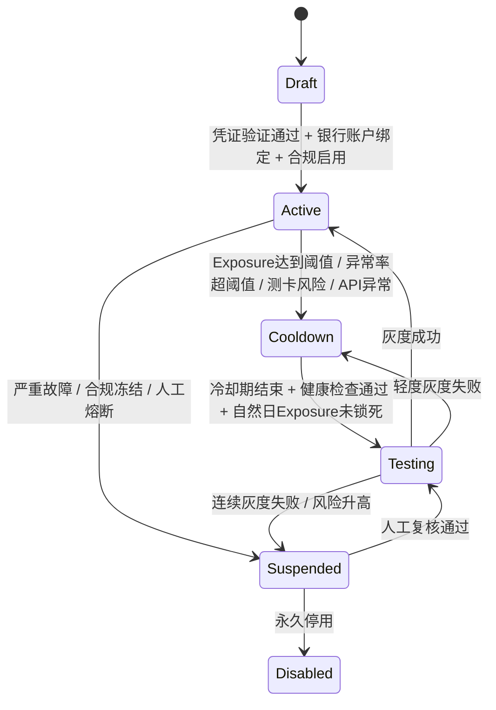

# NexusGlobal 全球财资调度与多轨收单均衡系统

## MAMR-System 产品需求文档 PRD V1.5 最终生产落地版

**文档类型：生产级 PRD / Enterprise FinTech TMS / Multi-Acquirer Routing / Multi-Rail Clearing / Dual-Entry Ledger / Liquidity Payout Console**
**适用对象：产品、架构、后端、前端、DBA、测试、风控、合规、财务运营、SRE、DevOps 团队**
**系统定位：面向多租户跨境 SaaS 平台的全球财资调度、多收单动态路由、多轨银行清算归集、商户双轨总账与终值代付清算后台**

---

# 0. V1.5 版本修订总览

## 0.1 本版核心修订

V1.5 在 V1.4 基础上补齐两项真实生产落地中的关键工程约束：

| 序号 | 生产暗坑                                          | V1.5 处理方式                                                                                         |
| -: | --------------------------------------------- | ------------------------------------------------------------------------------------------------- |
|  1 | 在数据库事务中调用第三方 LP API，导致事务长时间占用连接、锁表、连接池耗尽      | 明确禁止 DB Local Transaction 内执行任何外部网络 I/O；采用 **本地冻结事务 + Transactional Outbox + 异步 Worker + 二次确认事务** |
|  2 | Webhook Receiver 部署混乱或缺乏运维基线，造成不可审计、不可恢复、不可追踪 | 明确 Webhook Receiver 采用合规的 **故障域隔离、证书生命周期管理、Provider Allowlist、集中资产台账、统一审计**，不得用于误导合规或规避审查         |
|  3 | MAE 单日额度受退款回扣影响，可能误回池                         | 保留 `daily_gross_exposure_amount` 自然日内只增不减规则                                                       |
|  4 | MAE Cooldown 后直接 Active                       | 保留 `Cooldown -> Testing -> Active` 半开灰度恢复                                                         |
|  5 | Sweep 满额即扫导致银行 Pending 积压                     | 保留 `Tiered Scheduled Sweep`、银行 Cut-off、Redis Delay Queue                                          |
|  6 | Payout 并发双花                                   | 保留 `settled_balance -> frozen_payout_balance` 本地事务冻结机制                                            |
|  7 | 地址全密文不可核对                                     | 保留 `target_address_masked`、`target_address_hash`、`address_format_type`                            |

## 0.2 合规边界声明

本系统仅用于合法、透明、可审计的企业级 SaaS 收单、清算、财资归集与商户代付管理。

系统不得用于：

1. 隐藏真实交易主体、商品、服务或资金受益关系。
2. 规避银行、收单机构、卡组织、LP、监管机构或合作方的合规审查。
3. 绕过 KYB、KYC、AML、制裁筛查、交易监控、Travel Rule 或本地许可要求。
4. 误导合作方的风险识别、风控审核、审计或反欺诈系统。
5. 处理无法解释资金来源、无法识别最终受益人、无法完成交易背景证明的资金流。

本文档中的“动态拓扑隔离”“Webhook Receiver”“托管收银台”“多域环境隔离”仅用于：

* PCI 范围收敛。
* 零信任网络边界设计。
* API 暴露面最小化。
* 多租户隔离。
* 故障域隔离。
* Webhook 验签、日志留存、消息队列化。
* 防 Bot、防撞库、防测卡、防接口枚举。
* 审计、监控、故障恢复与资金安全。

---

# 1. 产品定位与系统目标

## 1.1 产品定位

NexusGlobal MAMR-System 是一套企业级全球财资调度与多轨收单均衡系统，用于支撑跨区域、多租户、多收单、多银行、多币种、多清算通道场景下的交易流与资金流管理。

系统由以下核心能力组成：

1. **MAE 多收单实体池化与动态路由**

   * 管理外部收单实体。
   * 基于额度、异常率、争议率、延迟、币种、租户、司法辖区执行动态路由。
   * 支持毫秒级熔断、半开灰度恢复、额度 Exposure 只增不减。

2. **托管收银台与统一鉴权**

   * 使用 Single-Use Token 将租户订单与托管收银台安全连接。
   * 控制来源域名、CORS、CSP、回跳地址、Token TTL、Token 使用次数。
   * 收敛 PCI 范围，降低租户前端对核心支付 API 的暴露。

3. **Webhook Receiver Decoupling Proxy**

   * 所有 MAE、银行、LP 的异步回调先进入边缘接收代理。
   * 接收代理仅负责验签、幂等、原始 Payload 加密、MQ 投递。
   * 核心系统通过 MQ 消费事件，不允许外部网络直连账务服务。

4. **全球多轨银行清算与阶梯式财资归集**

   * 管理 ACH、FedWire、SEPA、SWIFT、本地银行轨道。
   * 按银行工作日、Cut-off Time、节假日、同名/非同名规则执行 Sweep。
   * 支持 Tiered Scheduled Sweep，避免非工作窗口内高频提交银行 API。

5. **商户双轨制总账与冻结代付**

   * 以 Dual-Entry Ledger 为唯一资金真相来源。
   * 管理 Pending、Settled、Reserve、Frozen Payout、Dispute、Fee。
   * Payout 必须先在本地事务中冻结可用余额，再异步进行 LP 锁价与代付。

6. **LP 终值代付与对账**

   * 对接持牌 LP 或合规清算服务商。
   * 支持地址格式校验、地址白名单、AML / Sanctions 筛查、锁价、出金、Webhook 确认、对账单生成。

---

# 2. 全局系统资金与流量拓扑



---

# 3. 模块一：分布式收单实体池化配置控制台

## 3.1 功能目标

模块一负责管理所有 MAE 外部收单实体，并为路由网关提供：

1. 实时可用性。
2. 单日 / 单月额度控制。
3. Captured / Settled / Exposure 多口径指标。
4. 异常率、拒付率、退款率、争议率。
5. 测卡攻击识别。
6. 自动熔断。
7. Cooldown 后 Testing 灰度恢复。
8. 路由权重与租户范围控制。
9. 指标快照与审计日志。

## 3.2 MAE 状态机



## 3.3 核心额度口径

V1.5 明确区分三类额度：

| 指标      | 字段                                  | 是否可因退款实时减少 | 用途                  |
| ------- | ----------------------------------- | ---------: | ------------------- |
| 当日已扣款额  | `daily_captured_amount_minor`       |          否 | 衡量当日授权/扣款压力         |
| 当日已清算额  | `daily_settled_amount_minor`        |          否 | 衡量银行确权资金            |
| 当日总风险敞口 | `daily_gross_exposure_amount_minor` | 否，自然日内只增不减 | 熔断与出池主指标            |
| 当日退款额   | `daily_refund_amount_minor`         |     是，独立统计 | 风险监控，不用于降低 Exposure |
| 当日争议额   | `daily_dispute_amount_minor`        |     是，独立统计 | 风险监控，不用于降低 Exposure |

### 3.3.1 Exposure 只增不减原则

`daily_gross_exposure_amount_minor` 是 MAE 当日风险敞口主指标。

规则：

```text
daily_gross_exposure_amount_minor += captured_amount
daily_gross_exposure_amount_minor 不因 Refund / Chargeback / Void 实时扣减
daily_gross_exposure_amount_minor 在自然日结束后归档并重置
```

熔断条件：

```text
daily_gross_exposure_amount_minor >= daily_vmax_minor * 0.8
=> MAE Active -> Cooldown
```

自然日锁定规则：

```text
若 MAE 因 daily_gross_exposure_amount_minor 达到阈值进入 Cooldown，
则该 MAE 在当前业务自然日内不得自动恢复 Active。
只能在下一个业务日进入 Testing。
```

## 3.4 数据库表：`mae_configuration`

| 字段                           | 类型                 | 说明                                                         |
| ---------------------------- | ------------------ | ---------------------------------------------------------- |
| id                           | UUID PK            | 内部主键                                                       |
| mae_id                       | varchar(64) unique | MAE 唯一标识                                                   |
| display_name                 | varchar(128)       | 展示名                                                        |
| mae_type                     | varchar(32)        | CARD_GATEWAY / LOCAL_APM / BANK_TRANSFER / WALLET / A2A    |
| tenant_scope                 | jsonb              | 可服务租户范围                                                    |
| jurisdiction                 | varchar(8)         | 司法辖区                                                       |
| supported_currencies         | jsonb              | 支持币种                                                       |
| api_base_url                 | text               | 外部 API 地址                                                  |
| api_key_ciphertext           | bytea              | API Key 密文                                                 |
| webhook_secret_ciphertext    | bytea              | Webhook Secret 密文                                          |
| webhook_proxy_url            | varchar(512)       | 该 MAE 指定的 Webhook 接收代理 URL                                 |
| risk_label                   | varchar(128)       | 通道风险分类标签，用于内部路由与监控分组                                       |
| settlement_bank_account_id   | UUID FK            | 结算银行账户                                                     |
| daily_vmax_minor             | bigint             | 单日名义上限                                                     |
| monthly_vmax_minor           | bigint             | 单月名义上限                                                     |
| cmax_bps                     | integer            | 异常率阈值                                                      |
| card_testing_limit           | integer            | 测卡阈值                                                       |
| routing_weight               | integer            | 路由权重                                                       |
| cooldown_minutes             | integer            | 冷却时间                                                       |
| testing_traffic_bps          | integer            | Testing 灰度流量，默认 500 = 5%                                   |
| testing_min_txn_count        | integer            | Testing 最小交易数                                              |
| testing_min_success_rate_bps | integer            | Testing 最小成功率                                              |
| testing_max_p95_latency_ms   | integer            | Testing 最大 P95 延迟                                          |
| status                       | varchar(32)        | Draft / Active / Cooldown / Testing / Suspended / Disabled |
| status_reason                | varchar(128)       | 最近状态原因                                                     |
| business_day_lock_until      | date               | 因 Exposure 出池时锁定至业务日结束                                     |
| version                      | integer            | 乐观锁                                                        |
| created_at                   | timestamptz        | 创建时间                                                       |
| updated_at                   | timestamptz        | 更新时间                                                       |

## 3.5 数据库表：`mae_runtime_metric_snapshot`

该表只存 Redis 聚合后的快照，不做逐笔交易更新。

| 字段                                | 类型          | 说明          |
| --------------------------------- | ----------- | ----------- |
| id                                | UUID PK     | 主键          |
| mae_id                            | UUID FK     | MAE         |
| business_date                     | date        | 业务日期        |
| window_start                      | timestamptz | 窗口开始        |
| window_size_sec                   | integer     | 窗口大小        |
| txn_count                         | bigint      | 交易数         |
| approved_count                    | bigint      | 成功数         |
| declined_count                    | bigint      | 拒绝数         |
| captured_count                    | bigint      | Captured 笔数 |
| settled_count                     | bigint      | Settled 笔数  |
| refund_count                      | bigint      | Refund 笔数   |
| dispute_count                     | bigint      | Dispute 笔数  |
| daily_captured_amount_minor       | bigint      | 当日已扣款额      |
| daily_settled_amount_minor        | bigint      | 当日已清算额      |
| daily_gross_exposure_amount_minor | bigint      | 当日风险敞口，只增不减 |
| daily_refund_amount_minor         | bigint      | 当日退款额       |
| daily_dispute_amount_minor        | bigint      | 当日争议额       |
| card_testing_count                | bigint      | 测卡拦截数       |
| p95_latency_ms                    | integer     | P95 延迟      |
| abnormal_rate_bps                 | integer     | 异常率         |
| refund_rate_bps                   | integer     | 退款率         |
| dispute_rate_bps                  | integer     | 争议率         |
| active_concurrency                | integer     | 当前并发        |
| metric_version                    | bigint      | 指标版本        |
| version                           | integer     | 乐观锁         |
| created_at                        | timestamptz | 写入时间        |

## 3.6 指标更新策略

生产环境采用：

```text
交易事件 -> Redis Counter / Stream -> Sliding Window Aggregator -> Snapshot DB
```

Redis Key 示例：

```text
MAE_METRIC:{mae_id}:{business_date}:captured_amount
MAE_METRIC:{mae_id}:{business_date}:settled_amount
MAE_METRIC:{mae_id}:{business_date}:gross_exposure_amount
MAE_METRIC:{mae_id}:{business_date}:refund_amount
MAE_METRIC:{mae_id}:{business_date}:dispute_amount
```

重要规则：

```text
gross_exposure_amount 只允许 INCRBY
refund_amount 独立 INCRBY
dispute_amount 独立 INCRBY
不得使用 refund_amount 回扣 gross_exposure_amount
```

## 3.7 熔断规则

MAE 处于 Active 或 Testing 时，任一条件成立即触发状态变更：

| 条件                                                | 目标状态                                   |
| ------------------------------------------------- | -------------------------------------- |
| `daily_gross_exposure_amount >= daily_vmax * 0.8` | Cooldown，并设置 `business_day_lock_until` |
| 异常率超过 `cmax_bps`                                  | Cooldown                               |
| 测卡攻击计数超过阈值                                        | Cooldown                               |
| API 连续超时                                          | Cooldown                               |
| Webhook 验签失败异常升高                                  | Cooldown                               |
| 合规冻结                                              | Suspended                              |
| 管理员手动熔断                                           | Suspended                              |
| Testing 灰度失败                                      | Cooldown 或 Suspended                   |

## 3.8 Testing 灰度恢复规则

Cooldown 结束后，必须满足：

```text
cooldown_expired = true
AND health_check_passed = true
AND today_exposure_lock_expired = true
```

才允许进入 Testing。

Testing 转 Active：

```text
test_txn_count >= testing_min_txn_count
AND test_success_rate_bps >= testing_min_success_rate_bps
AND test_abnormal_rate_bps < cmax_bps * 0.5
AND p95_latency_ms <= testing_max_p95_latency_ms
AND card_testing_count = 0
```

Testing 失败：

```text
连续失败次数 >= 3
=> Suspended
```

---

# 4. 模块二：动态环境拓扑与 Webhook 回调解耦代理

## 4.1 功能目标

模块二用于管理：

1. 租户源域名。
2. 托管收银台域名。
3. Single-Use Token。
4. Webhook Receiver Decoupling Proxy。
5. 回调验签、幂等、MQ 投递、死信队列。
6. 外部网络与核心账务系统的解耦。
7. Receiver 运行环境的合规资产台账与证书生命周期管理。

## 4.2 拓扑原则

外部请求分两类：

| 请求类型     | 进入路径                                                                |
| -------- | ------------------------------------------------------------------- |
| 用户前端支付请求 | Tenant Source → API Gateway → Token → Hosted Checkout → MAE Routing |
| 外部异步回调   | MAE / Bank / LP → Webhook Receiver Proxy → MQ → Core Consumer       |

严格禁止：

```text
MAE / Bank / LP Webhook -> Core Payment API
MAE / Bank / LP Webhook -> Ledger Service
MAE / Bank / LP Webhook -> Database
```

## 4.3 Webhook Receiver 合规部署原则

Webhook Receiver 的部署目标是：

1. 降低核心系统外部暴露面。
2. 将外部回调接收、验签、日志留存、消息入队与资金账务处理解耦。
3. 提升故障隔离能力，避免某一接收节点故障影响核心账务。
4. 满足审计、证书管理、访问控制、日志留存要求。

Webhook Receiver 不得用于：

1. 隐藏真实交易主体。
2. 误导收单机构、银行、LP 或合作方的风控系统。
3. 规避合规、监管、审计或反欺诈审查。
4. 伪造、混淆或错误展示商户、服务、账单描述符或回调关系。

## 4.4 Webhook Receiver 运维基线

| 项目                 | 要求                                                      |
| ------------------ | ------------------------------------------------------- |
| 资产台账               | 每个 Receiver 节点必须登记 `proxy_code`、域名、证书、Provider、负责人、部署区域 |
| 证书管理               | 证书必须有到期监控、自动续期、吊销记录，不允许无主证书                             |
| Provider Allowlist | 支持按 Provider 配置 IP Allowlist、签名算法、Secret Version        |
| 日志留存               | 原始 Payload 加密存储，访问日志不可篡改                                |
| 最小权限               | Receiver 不得持有数据库写权限，不得持有 LP 出金权限                        |
| 密钥隔离               | Webhook Secret 必须使用 KMS/HSM 托管                          |
| 故障域隔离              | Receiver 可按区域、Provider、租户范围分组，故障不得扩散至核心账务服务             |
| 统一审计               | 所有 Receiver 配置变更必须进入审计日志                                |
| SLO                | Webhook 验签入队 P95 ≤100ms                                 |
| DLQ                | 验签失败、MQ 投递失败、消费者失败必须进入 Dead Letter Queue                |

## 4.5 数据库表：`webhook_receiver_proxy`

| 字段                      | 类型                 | 说明                         |
| ----------------------- | ------------------ | -------------------------- |
| id                      | UUID PK            | 主键                         |
| proxy_code              | varchar(64) unique | 接收代理编码                     |
| proxy_url               | varchar(512)       | 接收代理 URL                   |
| provider_type           | varchar(32)        | MAE / BANK / LP            |
| provider_id             | UUID               | 绑定提供方                      |
| tenant_scope            | jsonb              | 可服务租户范围                    |
| region                  | varchar(32)        | 部署区域                       |
| environment             | varchar(32)        | PROD / STAGING / SANDBOX   |
| health_status           | varchar(32)        | Healthy / Degraded / Down  |
| rate_limit_per_minute   | integer            | 限流                         |
| signature_algorithm     | varchar(64)        | HMAC_SHA256 / RSA_SHA256   |
| secret_version          | varchar(32)        | 当前 Secret 版本               |
| certificate_fingerprint | varchar(128)       | 证书指纹，用于资产台账                |
| certificate_expires_at  | timestamptz        | 证书到期时间                     |
| mq_topic                | varchar(128)       | 投递 Topic                   |
| status                  | varchar(32)        | Active / Paused / Disabled |
| version                 | integer            | 乐观锁                        |
| created_at              | timestamptz        | 创建时间                       |
| updated_at              | timestamptz        | 更新时间                       |

## 4.6 数据库表：`webhook_ingress_event`

| 字段                     | 类型                  | 说明                                                              |
| ---------------------- | ------------------- | --------------------------------------------------------------- |
| id                     | UUID PK             | 主键                                                              |
| proxy_id               | UUID FK             | 接收代理                                                            |
| provider_type          | varchar(32)         | MAE / BANK / LP                                                 |
| provider_id            | UUID                | 提供方 ID                                                          |
| provider_event_id      | varchar(128)        | 外部事件 ID                                                         |
| event_type             | varchar(64)         | Captured / Settled / Refund / Dispute / PayoutConfirmed 等       |
| signature_valid        | boolean             | 验签是否通过                                                          |
| raw_payload_ciphertext | bytea               | 原始 Payload 密文                                                   |
| payload_hash           | varchar(128)        | Payload 哈希                                                      |
| idempotency_key        | varchar(128) unique | 幂等键                                                             |
| mq_topic               | varchar(128)        | MQ Topic                                                        |
| mq_partition           | integer             | MQ Partition                                                    |
| mq_offset              | varchar(128)        | MQ Offset                                                       |
| status                 | varchar(32)         | Received / Verified / Queued / Consumed / Rejected / DeadLetter |
| received_at            | timestamptz         | 接收时间                                                            |
| consumed_at            | timestamptz         | 消费时间                                                            |

## 4.7 Webhook Proxy 处理流程

```text
1. 接收外部 Webhook
2. 校验 TLS、IP Allowlist、Rate Limit
3. 校验签名
4. 计算 payload_hash
5. 生成 idempotency_key
6. 加密存储 raw_payload
7. 写入 webhook_ingress_event
8. 投递 MQ
9. 核心消费者异步消费
10. 消费失败进入 DLQ
```

## 4.8 幂等键规则

```text
idempotency_key =
hash(provider_type + provider_id + provider_event_id + event_type)
```

若外部系统不提供 `provider_event_id`：

```text
idempotency_key =
hash(provider_type + provider_id + payload_hash + received_business_date)
```

## 4.9 核心消费者约束

核心系统消费 MQ 后才允许更新业务状态。

消费者必须执行：

1. 幂等检查。
2. 状态机单调流转检查。
3. Ledger 事务入账。
4. Outbox 事件写入。
5. 对账事件生成。

---

# 5. 模块三：全球多轨银行清算网络与阶梯式财资归集引擎

## 5.1 功能目标

模块三负责：

1. 银行账户管理。
2. 银行清算轨道分类。
3. Banking Calendar 与 Cut-off Time 管理。
4. Tiered Scheduled Sweep。
5. Same-Name / Third-Party 校验。
6. Redis Delay Queue。
7. Sweep 分布式锁。
8. 银行 API UnknownExternalState 处理。

## 5.2 Sweep 策略升级

V1.5 不采用“满额即扫”作为默认策略，而采用：

```text
金额累计 + 银行窗口判断 + 阶梯式定时归集
```

默认模式：

| 模式                     | 说明                   |
| ---------------------- | -------------------- |
| Threshold Accumulation | 非窗口期只累计金额，不提交银行 API  |
| Tiered Scheduled Sweep | 在指定银行窗口内集中执行 1-2 笔归集 |
| Emergency Sweep        | 风险事件触发，经审批后立即归集      |
| Manual Sweep           | 管理员人工复核后执行           |

## 5.3 数据库表：`banking_calendar`

| 字段                      | 类型           | 说明                     |
| ----------------------- | ------------ | ---------------------- |
| id                      | UUID PK      | 主键                     |
| calendar_name           | varchar(128) | 日历名称                   |
| jurisdiction            | varchar(8)   | 司法辖区                   |
| timezone                | varchar(64)  | 时区                     |
| business_days           | jsonb        | 工作日                    |
| holidays                | jsonb        | 节假日                    |
| emergency_closure_dates | jsonb        | 临时关闭日                  |
| cut_off_matrix          | jsonb        | 不同 Rail 的 Cut-off Time |
| status                  | varchar(32)  | Active / Paused        |
| created_at              | timestamptz  | 创建时间                   |
| updated_at              | timestamptz  | 更新时间                   |

## 5.4 数据库表：`sweep_rule`

| 字段                       | 类型             | 说明                                                           |
| ------------------------ | -------------- | ------------------------------------------------------------ |
| id                       | UUID PK        | 主键                                                           |
| source_bank_account_id   | UUID FK        | 来源账户                                                         |
| target_bank_account_id   | UUID FK        | 目标账户                                                         |
| currency                 | varchar(3)     | 币种                                                           |
| rail                     | varchar(32)    | ACH / FedWire / SEPA / SWIFT                                 |
| beneficiary_type         | varchar(32)    | SAME_NAME / THIRD_PARTY / THIRD_PARTY_CROSS_BORDER / UNKNOWN |
| same_name_verified       | boolean        | 是否已验证同名                                                      |
| trigger_threshold_minor  | bigint         | 累计触发阈值                                                       |
| sweep_ratio_bps          | integer        | 归集比例                                                         |
| max_single_sweep_minor   | bigint         | 单笔最大金额                                                       |
| min_residual_minor       | bigint         | 保留余额                                                         |
| time_window_matrix       | jsonb not null | 银行营业窗口矩阵                                                     |
| scheduled_sweep_times    | jsonb          | 定时归集时间，如每日窗口关闭前 1 小时                                         |
| sweep_mode               | varchar(32)    | THRESHOLD / TIERED_SCHEDULED / EMERGENCY / MANUAL            |
| max_daily_sweep_count    | integer        | 每日最大归集次数                                                     |
| delay_queue_enabled      | boolean        | 是否启用延迟队列                                                     |
| require_four_eyes        | boolean        | 是否四眼复核                                                       |
| approval_threshold_minor | bigint         | 审批阈值                                                         |
| status                   | varchar(32)    | Active / Paused                                              |
| version                  | integer        | 乐观锁                                                          |
| created_at               | timestamptz    | 创建时间                                                         |

## 5.5 数据库表：`sweep_transfer`

| 字段                     | 类型                  | 说明                                                                                                                                       |
| ---------------------- | ------------------- | ---------------------------------------------------------------------------------------------------------------------------------------- |
| id                     | UUID PK             | 主键                                                                                                                                       |
| sweep_rule_id          | UUID FK             | 规则                                                                                                                                       |
| source_bank_account_id | UUID FK             | 来源账户                                                                                                                                     |
| target_bank_account_id | UUID FK             | 目标账户                                                                                                                                     |
| amount_minor           | bigint              | 金额                                                                                                                                       |
| currency               | varchar(3)          | 币种                                                                                                                                       |
| rail                   | varchar(32)         | 轨道                                                                                                                                       |
| beneficiary_type       | varchar(32)         | 受益人类型                                                                                                                                    |
| status                 | varchar(32)         | Accumulating / Delayed / ApprovalRequired / Locked / Submitted / Confirmed / ComplianceHold / UnknownExternalState / Reconciled / Failed |
| bank_reference_id      | varchar(128)        | 银行参考号                                                                                                                                    |
| idempotency_key        | varchar(128) unique | 幂等键                                                                                                                                      |
| approval_ticket_id     | UUID                | 审批工单                                                                                                                                     |
| next_execution_at      | timestamptz         | 下一次执行时间                                                                                                                                  |
| locked_at              | timestamptz         | 锁定时间                                                                                                                                     |
| submitted_at           | timestamptz         | 提交时间                                                                                                                                     |
| confirmed_at           | timestamptz         | 确认时间                                                                                                                                     |
| created_at             | timestamptz         | 创建时间                                                                                                                                     |

## 5.6 Sweep 触发规则

### 5.6.1 非窗口期

```text
if not within banking window:
    status = Accumulating 或 Delayed
    push to Redis Delay Queue
    do not call Bank API
```

### 5.6.2 定时窗口期

```text
if now within scheduled_sweep_times
AND accumulated_amount >= trigger_threshold
AND daily_sweep_count < max_daily_sweep_count
AND beneficiary rule passed
AND approval rule passed
=> create sweep_transfer
=> status = Locked
=> submit Bank API
```

## 5.7 Redis Delay Queue Key

```text
SWEEP_DELAY:{rail}:{source_bank_account_id}:{currency}:{next_execution_at}
```

## 5.8 Same-Name / Third-Party 规则

| 类型                       | 处理                  |
| ------------------------ | ------------------- |
| SAME_NAME + verified     | 可自动执行               |
| SAME_NAME + unverified   | 进入 ApprovalRequired |
| THIRD_PARTY              | 达阈值四眼复核             |
| THIRD_PARTY_CROSS_BORDER | 合规复核 + 四眼复核         |
| UNKNOWN                  | 禁止执行                |

规则：

```text
beneficiary_type = UNKNOWN
=> reject sweep

beneficiary_type IN (THIRD_PARTY, THIRD_PARTY_CROSS_BORDER)
AND amount_minor >= approval_threshold_minor
=> ApprovalRequired
```

## 5.9 银行 API 超时

```text
Bank API timeout != Failed
Bank API timeout => UnknownExternalState
UnknownExternalState => 查询银行转账状态 / 等待 Webhook / 人工对账
禁止盲目重复提交
```

---

# 6. 模块四：商户双轨制总账与强冻结代付控制台

## 6.1 功能目标

模块四负责：

1. 商户总账。
2. Pending / Settled / Reserve / Frozen Payout 分类。
3. Rolling Reserve。
4. 出金地址管理。
5. LP 锁价。
6. 强资金冻结。
7. Payout Confirm / Failed 账务闭环。
8. 并发双花防护。
9. Transactional Outbox 驱动的异步 LP 调用。

## 6.2 总账资金口径

| 账户                       | 含义           |
| ------------------------ | ------------ |
| pending_balance          | 已支付但未银行确认    |
| settled_balance          | 银行已确认可用余额    |
| reserve_balance          | 风险拨备 / 滚动保证金 |
| frozen_payout_balance    | 出金处理中冻结余额    |
| dispute_hold_balance     | 争议冻结余额       |
| available_payout_balance | 可申请出金余额      |

计算公式：

```text
available_payout_balance =
settled_balance
- reserve_balance
- frozen_payout_balance
- dispute_hold_balance
```

## 6.3 核心硬约束：DB 事务内禁止外部 I/O

### 6.3.1 禁止行为

以下行为严禁出现在数据库本地事务中：

```text
BEGIN TRANSACTION
    UPDATE merchant_treasury_ledger ...
    CALL LP FX LOCK API
    CALL LP PAYOUT API
COMMIT
```

禁止原因：

1. 外部网络请求不可控，可能阻塞数秒至数十秒。
2. 长事务会持有行锁、连接、事务快照。
3. 高并发下会导致数据库连接池耗尽。
4. 可能扩大死锁范围。
5. 会导致核心账务服务级联阻塞。

### 6.3.2 正确模式

必须采用：

```text
本地事务冻结资金
    -> COMMIT
    -> 写入 Transactional Outbox
    -> 异步 Worker 调用 LP
    -> 根据 LP 结果开启第二个本地事务
    -> Confirm 则核销 Frozen
    -> Failed 则释放 Frozen
    -> Unknown 则保持 Frozen 并查询最终状态
```

---

## 6.4 数据库表：`merchant_treasury_ledger`

该表为商户余额快照与并发控制表，不替代 Dual-Entry Ledger。

| 字段                       | 类型            | 说明      |
| ------------------------ | ------------- | ------- |
| id                       | UUID PK       | 主键      |
| merchant_id              | UUID FK       | 商户      |
| currency                 | varchar(16)   | 币种      |
| pending_balance          | decimal(20,4) | 在途余额    |
| settled_balance          | decimal(20,4) | 已清算可用余额 |
| reserve_balance          | decimal(20,4) | 风险拨备余额  |
| frozen_payout_balance    | decimal(20,4) | 出金冻结余额  |
| dispute_hold_balance     | decimal(20,4) | 争议冻结余额  |
| available_payout_balance | decimal(20,4) | 可出金余额   |
| version                  | integer       | 乐观锁     |
| updated_at               | timestamptz   | 更新时间    |

## 6.5 数据库表：`ledger_account`

| 字段           | 类型          | 说明                                                                            |
| ------------ | ----------- | ----------------------------------------------------------------------------- |
| id           | UUID PK     | 主键                                                                            |
| merchant_id  | UUID FK     | 商户                                                                            |
| account_type | varchar(32) | PENDING / SETTLED / RESERVE / FROZEN_PAYOUT / DISPUTE / FEE / EXTERNAL_PAYOUT |
| currency     | varchar(16) | 币种                                                                            |
| status       | varchar(32) | Active / Frozen / Closed                                                      |
| created_at   | timestamptz | 创建时间                                                                          |

## 6.6 数据库表：`ledger_transaction`

| 字段                | 类型                  | 说明                                                                                                |
| ----------------- | ------------------- | ------------------------------------------------------------------------------------------------- |
| id                | UUID PK             | 主键                                                                                                |
| source_event_type | varchar(64)         | BANK_SETTLEMENT / RESERVE_HOLD / PAYOUT_FREEZE / PAYOUT_CONFIRM / PAYOUT_RELEASE / FEE / REVERSAL |
| source_event_id   | varchar(128)        | 来源事件                                                                                              |
| idempotency_key   | varchar(128) unique | 幂等键                                                                                               |
| amount            | decimal(20,4)       | 金额                                                                                                |
| currency          | varchar(16)         | 币种                                                                                                |
| status            | varchar(32)         | Posted / Reversed                                                                                 |
| created_at        | timestamptz         | 创建时间                                                                                              |

## 6.7 数据库表：`ledger_entry`

| 字段                    | 类型            | 说明             |
| --------------------- | ------------- | -------------- |
| id                    | UUID PK       | 主键             |
| ledger_transaction_id | UUID FK       | 交易             |
| ledger_account_id     | UUID FK       | 账户             |
| direction             | varchar(8)    | DEBIT / CREDIT |
| amount                | decimal(20,4) | 金额             |
| currency              | varchar(16)   | 币种             |
| created_at            | timestamptz   | 创建时间           |

## 6.8 数据库表：`merchant_payout_address`

| 字段                        | 类型           | 说明                                 |
| ------------------------- | ------------ | ---------------------------------- |
| id                        | UUID PK      | 主键                                 |
| merchant_id               | UUID FK      | 商户                                 |
| target_asset              | varchar(16)  | USDT / USDC / BTC / ETH            |
| target_network            | varchar(32)  | TRON_TRC20 / ETH_ERC20 / BTC / SOL |
| address_format_type       | varchar(32)  | 显式协议标签，如 TRON_TRC20 / ETH_ERC20    |
| target_address_ciphertext | bytea        | 地址密文                               |
| target_address_masked     | varchar(128) | 地址掩码                               |
| target_address_hash       | varchar(128) | 地址哈希，用于去重和黑名单匹配                    |
| address_label             | varchar(128) | 地址备注                               |
| screening_status          | varchar(32)  | Pending / Passed / Failed / Review |
| whitelist_status          | varchar(32)  | Pending / Active / Suspended       |
| created_at                | timestamptz  | 创建时间                               |
| updated_at                | timestamptz  | 更新时间                               |

地址掩码示例：

```text
ETH_ERC20: 0x71C2****3a94
TRON_TRC20: TQ9a31****8xLm
BTC: bc1q2x****9p7z
SOL: 7YxA9q****PQ3m
```

## 6.9 数据库表：`payout_request`

| 字段                    | 类型                  | 说明                                                                                                                                                                        |
| --------------------- | ------------------- | ------------------------------------------------------------------------------------------------------------------------------------------------------------------------- |
| id                    | UUID PK             | 主键                                                                                                                                                                        |
| merchant_id           | UUID FK             | 商户                                                                                                                                                                        |
| payout_address_id     | UUID FK             | 出金地址                                                                                                                                                                      |
| amount                | decimal(20,4)       | 法币金额                                                                                                                                                                      |
| fiat_currency         | varchar(3)          | 法币                                                                                                                                                                        |
| target_asset          | varchar(16)         | 目标资产                                                                                                                                                                      |
| target_network        | varchar(32)         | 网络                                                                                                                                                                        |
| target_address_masked | varchar(128)        | 地址掩码快照                                                                                                                                                                    |
| lp_id                 | UUID FK             | LP                                                                                                                                                                        |
| fx_lock_id            | UUID FK             | 锁价 ID                                                                                                                                                                     |
| ledger_freeze_txn_id  | UUID FK             | 冻结账务交易                                                                                                                                                                    |
| status                | varchar(32)         | Draft / BalanceFrozen / Screening / FxLockPending / FxLocked / PayoutSubmitting / LPProcessing / Confirmed / Failed / BalanceReleased / UnknownExternalState / Reconciled |
| idempotency_key       | varchar(128) unique | 幂等键                                                                                                                                                                       |
| created_at            | timestamptz         | 创建时间                                                                                                                                                                      |
| updated_at            | timestamptz         | 更新时间                                                                                                                                                                      |

## 6.10 数据库表：`transactional_outbox`

| 字段              | 类型                  | 说明                                                                  |
| --------------- | ------------------- | ------------------------------------------------------------------- |
| id              | UUID PK             | 主键                                                                  |
| aggregate_type  | varchar(64)         | PayoutRequest / SweepTransfer / LedgerTransaction                   |
| aggregate_id    | UUID                | 聚合根 ID                                                              |
| event_type      | varchar(64)         | FX_LOCK_REQUESTED / LP_PAYOUT_REQUESTED / PAYOUT_RECONCILE_REQUIRED |
| payload         | jsonb               | 事件载荷，不含明文敏感字段                                                       |
| idempotency_key | varchar(128) unique | 幂等键                                                                 |
| status          | varchar(32)         | Pending / Processing / Succeeded / Failed / DeadLetter              |
| retry_count     | integer             | 重试次数                                                                |
| next_retry_at   | timestamptz         | 下次重试时间                                                              |
| locked_by       | varchar(128)        | Worker ID                                                           |
| locked_at       | timestamptz         | Worker 锁定时间                                                         |
| created_at      | timestamptz         | 创建时间                                                                |
| updated_at      | timestamptz         | 更新时间                                                                |

---

# 7. Payout 本地事务冻结与异步 LP 调用流程

## 7.1 Phase 1：本地事务冻结资金

```text
BEGIN TRANSACTION

1. SELECT *
   FROM merchant_treasury_ledger
   WHERE merchant_id = :merchant_id
   AND currency = :currency
   FOR UPDATE;

2. 校验:
   settled_balance - reserve_balance - frozen_payout_balance - dispute_hold_balance >= payout_amount

3. 更新余额快照:
   settled_balance = settled_balance - payout_amount
   frozen_payout_balance = frozen_payout_balance + payout_amount
   available_payout_balance = recalculated

4. 创建 ledger_transaction:
   source_event_type = PAYOUT_FREEZE

5. 创建双轨分录:
   Dr Merchant Settled Account
   Cr Merchant Frozen Payout Account

6. 创建 payout_request:
   status = BalanceFrozen

7. 创建 transactional_outbox:
   event_type = FX_LOCK_REQUESTED
   status = Pending

COMMIT
```

事务内只允许：

1. 余额校验。
2. 行级锁。
3. 余额快照更新。
4. Ledger 分录写入。
5. Payout Request 写入。
6. Outbox 事件写入。

事务内禁止：

1. LP FX Lock API。
2. LP Payout API。
3. 银行 API。
4. 任何 HTTP / gRPC / 外部网络 I/O。
5. 任何不可控耗时任务。

## 7.2 Phase 2：异步 Worker 请求 FX Lock

```text
1. Worker 拉取 transactional_outbox where event_type = FX_LOCK_REQUESTED
2. 使用 SKIP LOCKED 或 Worker Lock 抢占任务
3. 调用 LP FX Lock API
4. 成功：
   - 更新 payout_request.status = FxLocked
   - 写入 outbox: LP_PAYOUT_REQUESTED
5. 失败：
   - 若明确失败，进入 BalanceRelease 流程
   - 若超时，进入 UnknownExternalState
```

## 7.3 Phase 3：异步 Worker 提交 LP Payout

```text
1. Worker 拉取 LP_PAYOUT_REQUESTED
2. 校验 payout_request.status = FxLocked
3. 调用 LP Payout API
4. 成功提交：
   - payout_request.status = LPProcessing
5. 明确失败：
   - payout_request.status = Failed
   - 触发 BalanceRelease
6. 超时或状态未知：
   - payout_request.status = UnknownExternalState
   - 保持 frozen_payout_balance 不释放
```

## 7.4 Phase 4：LP Confirmed 后核销 Frozen

```text
BEGIN TRANSACTION

1. 幂等校验 LP provider_event_id
2. SELECT payout_request FOR UPDATE
3. 校验状态为 LPProcessing 或 UnknownExternalState
4. 创建 ledger_transaction:
   source_event_type = PAYOUT_CONFIRM

5. 创建双轨分录:
   Dr Merchant Frozen Payout Account
   Cr External Payout Settlement Account

6. 更新 merchant_treasury_ledger:
   frozen_payout_balance -= payout_amount
   available_payout_balance = recalculated

7. 更新 payout_request.status = Confirmed

COMMIT
```

## 7.5 Phase 5：LP Failed 后释放 Frozen

```text
BEGIN TRANSACTION

1. 幂等校验失败事件
2. SELECT payout_request FOR UPDATE
3. 校验状态允许释放
4. 创建 ledger_transaction:
   source_event_type = PAYOUT_RELEASE

5. 创建双轨分录:
   Dr Merchant Frozen Payout Account
   Cr Merchant Settled Account

6. 更新 merchant_treasury_ledger:
   frozen_payout_balance -= payout_amount
   settled_balance += payout_amount
   available_payout_balance = recalculated

7. 更新 payout_request.status = BalanceReleased

COMMIT
```

## 7.6 UnknownExternalState 规则

```text
LP timeout != Failed
LP timeout => UnknownExternalState
UnknownExternalState 期间 frozen_payout_balance 不释放
必须通过 LP 查询接口、Webhook 或人工对账确认最终状态
```

---

# 8. 地址格式清洗规则

出金请求进入系统后，必须执行：

```text
1. trim 空格
2. 去除不可见字符
3. 校验 address_format_type 与 target_network 一致
4. 按网络执行专用格式校验
5. 生成 normalized_address
6. 生成 target_address_hash
7. 匹配黑名单与白名单
8. 通过后再允许进入 Payout 流程
```

网络校验：

| 网络         | 校验                    |
| ---------- | --------------------- |
| TRON_TRC20 | Base58Check，常见以 T 开头  |
| ETH_ERC20  | `^0x[a-fA-F0-9]{40}$` |
| BTC        | Bech32 / Base58 校验    |
| SOL        | Base58 长度与格式校验        |

---

# 9. 高并发与异常边界处理

## 9.1 测卡攻击防御

触发条件示例：

```text
invalid_card_rate_60s > 30%
OR unique_card_count_per_ip_60s > 10
OR decline_count_per_tenant_60s > 100
OR card_testing_count_per_mae_60s > configured_limit
```

动作：

1. Edge 层拒绝高风险请求。
2. Payment Intent 标记为 `RiskRejected`。
3. 不向 MAE 继续发送明显异常流量。
4. MAE 进入 Cooldown。
5. 路由网关 100ms 内剔除 MAE。
6. Cooldown 后必须进入 Testing。
7. 因 Exposure 出池的 MAE，当日不得自动回 Active。

## 9.2 Webhook 重复与延迟

所有 Webhook 事件必须满足：

1. Provider Event ID 唯一。
2. Idempotency-Key 唯一。
3. Payload Hash 可追溯。
4. 状态机单调流转。
5. Ledger Transaction 唯一。
6. 重复 Webhook 不重复入账。

## 9.3 分布式锁原则

| 场景            | 主锁                          | 辅助锁                    |
| ------------- | --------------------------- | ---------------------- |
| MAE 状态迁移      | DB 乐观锁 version              | Redis Lock             |
| Sweep 提交      | DB 行级锁                      | Redis Delay Queue Lock |
| Payout 冻结     | DB `FOR UPDATE`             | 不依赖 Redis 作为资金边界       |
| Outbox Worker | `SKIP LOCKED` / Worker Lock | Redis Worker Lease     |
| Ledger 入账     | DB 本地事务                     | Idempotency-Key        |

原则：

```text
Redis Lock 不作为最终资金安全边界
资金安全边界必须是数据库本地事务 + 唯一约束 + 行级锁 + 幂等键
```

## 9.4 UnknownExternalState 处理

```text
External API timeout != Failed
Timeout => UnknownExternalState
UnknownExternalState 不允许盲重试资金提交
必须查询外部最终状态
```

适用：

1. MAE Payment。
2. Bank Sweep。
3. LP Payout。

---

# 10. 非功能性需求

## 10.1 幂等性

强制幂等对象：

* Payment Intent。
* Token 生成与兑换。
* MAE 路由提交。
* Webhook 事件。
* Sweep Transfer。
* Ledger Transaction。
* Reserve Hold。
* Payout Freeze。
* FX Lock。
* LP Payout。
* Reconciliation Adjustment。

规则：

| 规则           | 要求                                             |
| ------------ | ---------------------------------------------- |
| Header       | 写接口必须支持 `Idempotency-Key`                      |
| Payload Hash | 同 Key 请求体必须一致                                  |
| 重放结果         | 同 Key 同 Payload 返回首次结果                         |
| 冲突           | 同 Key 不同 Payload 返回 `409 IDEMPOTENCY_CONFLICT` |
| 保存周期         | 支付、账务、出金类至少 365 天                              |
| 唯一索引         | DB 必须建立唯一约束                                    |

## 10.2 加密存储

敏感字段使用 AES-256-GCM：

* API Key。
* Webhook Secret。
* 银行账号。
* ABA Routing Number。
* IBAN。
* 链上地址。
* LP API 凭证。
* 商户敏感识别信息。

Envelope Encryption：

```text
Master Key: KMS / HSM
DEK: tenant_id + data_type
Algorithm: AES-256-GCM
IV: 96-bit unique nonce
AAD: tenant_id + record_id + field_name + key_version
Auth Tag: 128-bit
```

## 10.3 事务一致性

1. Ledger 是资金真相来源。
2. 余额快照仅用于查询和并发控制。
3. 不允许直接手工修改余额。
4. 所有资金修正必须通过冲正分录。
5. Payout 必须先冻结后锁价。
6. Sweep 必须先锁定后提交。
7. Webhook 可以重复，账务不能重复。
8. 外部 API 超时不得盲重试。
9. 冻结资金不得再次参与 Available Payout 计算。
10. Exposure 熔断不得因退款实时解除。
11. **数据库本地事务中禁止外部网络 I/O。**
12. **调用 LP / Bank / MAE 外部 API 必须通过 Outbox / Worker / Saga 执行。**

## 10.4 性能指标

| 指标                     |     目标 |
| ---------------------- | -----: |
| MAE L1 熔断生效            | ≤100ms |
| Payment Intent 创建 P95  | ≤150ms |
| Token 生成 P95           | ≤100ms |
| Webhook Proxy 验签入队 P95 | ≤100ms |
| Ledger 入账 P95          | ≤200ms |
| Payout Freeze 本地事务 P95 | ≤200ms |
| Sweep 判断 P95           | ≤300ms |
| Outbox Worker 任务拉取 P95 | ≤100ms |
| RPO                    |  ≤5 分钟 |
| RTO                    | ≤30 分钟 |

---

# 11. 后端接口总览

## 11.1 MAE 管理接口

| 方法    | 路径                                        | 说明     |
| ----- | ----------------------------------------- | ------ |
| POST  | `/admin/mae`                              | 创建 MAE |
| PATCH | `/admin/mae/{mae_id}`                     | 更新 MAE |
| POST  | `/admin/mae/{mae_id}/rotate-secret`       | 轮换凭证   |
| POST  | `/admin/mae/{mae_id}/status`              | 手动状态变更 |
| GET   | `/admin/mae/{mae_id}/metrics`             | 查询实时指标 |
| POST  | `/internal/mae/{mae_id}/circuit-break`    | 内部熔断   |
| POST  | `/internal/mae/{mae_id}/testing-evaluate` | 灰度评估   |

## 11.2 Webhook Proxy 接口

| 方法   | 路径                                  | 说明       |
| ---- | ----------------------------------- | -------- |
| POST | `/webhook/mae/{provider_id}`        | MAE 回调入口 |
| POST | `/webhook/bank/{provider_id}`       | 银行回调入口   |
| POST | `/webhook/lp/{provider_id}`         | LP 回调入口  |
| GET  | `/admin/webhook/events`             | 查询回调事件   |
| POST | `/admin/webhook/events/{id}/replay` | 重放回调事件   |

## 11.3 Treasury / Sweep 接口

| 方法    | 路径                               | 说明     |
| ----- | -------------------------------- | ------ |
| POST  | `/admin/banking-calendar`        | 创建银行日历 |
| POST  | `/admin/sweep-rule`              | 创建归集规则 |
| PATCH | `/admin/sweep-rule/{id}`         | 更新归集规则 |
| POST  | `/internal/sweep/evaluate`       | 触发归集评估 |
| POST  | `/internal/sweep/{id}/submit`    | 提交归集   |
| POST  | `/internal/sweep/{id}/reconcile` | 对账归集   |

## 11.4 Ledger / Payout 接口

| 方法   | 路径                                | 说明                   |
| ---- | --------------------------------- | -------------------- |
| GET  | `/admin/merchant/{id}/balance`    | 查询商户余额               |
| POST | `/merchant/payout-address`        | 添加出金地址               |
| POST | `/merchant/payout-request`        | 创建代付请求               |
| POST | `/internal/payout/{id}/freeze`    | 本地事务冻结余额             |
| POST | `/internal/payout/{id}/fx-lock`   | 仅供 Worker 内部调用 LP 锁价 |
| POST | `/internal/payout/{id}/submit`    | 仅供 Worker 内部提交 LP 代付 |
| POST | `/internal/payout/{id}/reconcile` | 对账代付                 |
| GET  | `/admin/outbox`                   | 查询 Outbox 任务         |
| POST | `/admin/outbox/{id}/replay`       | 重放 Outbox 任务         |

---

# 12. 验收标准

## 12.1 MAE 模块验收

* MAE 支持 Draft、Active、Cooldown、Testing、Suspended、Disabled。
* 因 Exposure 达阈值出池后，当日不得自动恢复 Active。
* `daily_gross_exposure_amount` 只增不减，不因退款回扣。
* Cooldown 后必须进入 Testing。
* Testing 只承接 5%-10% 流量。
* Redis Counter 支持实时熔断。
* DB 只存 Snapshot。
* 所有状态变更写审计日志。

## 12.2 Webhook 模块验收

* 所有外部 Webhook 必须进入 Receiver Proxy。
* Proxy 不直连账务服务和数据库。
* Proxy 只负责验签、幂等、加密 Raw Payload、MQ 投递。
* Receiver 节点必须有资产台账、证书监控、Secret Version、Provider Allowlist。
* 重复 Webhook 不重复入账。
* MQ 失败进入 DLQ。
* 后台支持事件重放。

## 12.3 Sweep 模块验收

* Sweep 不得仅按金额触发。
* 非银行工作窗口不得调用银行 API。
* 非窗口期资金只累计或进入 Delay Queue。
* 支持 Tiered Scheduled Sweep。
* 支持每日最大归集次数。
* 非同名大额划转进入 ApprovalRequired。
* 银行 API 超时进入 UnknownExternalState。
* 不允许盲重试资金提交。

## 12.4 Payout 模块验收

* Payout 请求必须先执行本地冻结事务。
* 冻结失败不得调用 LP。
* 本地事务使用 `FOR UPDATE` 锁定商户余额行。
* DB 事务内不得出现任何 LP / Bank / MAE 外部网络 I/O。
* 冻结时减少 `settled_balance`，增加 `frozen_payout_balance`。
* 冻结成功后写入 `transactional_outbox`。
* Worker 异步调用 LP FX Lock 与 LP Payout。
* LP Confirmed 后核销冻结余额。
* LP Failed 后释放冻结余额。
* UnknownExternalState 期间不得释放冻结余额。
* 并发 5 笔相同余额出金请求时，只允许余额覆盖范围内的请求成功。
* 地址必须经过格式清洗、协议校验、白名单校验、AML 筛查。

---

# 13. 推荐服务拆分

| 服务                       | 职责                     |
| ------------------------ | ---------------------- |
| api-gateway              | 统一入口、鉴权、限流             |
| hosted-checkout-service  | 托管收银台                  |
| checkout-token-service   | Single-Use Token       |
| webhook-receiver-service | Webhook 边缘接收、验签、MQ 投递  |
| routing-service          | MAE 路由、熔断、Testing      |
| risk-engine              | 测卡、防欺诈、异常评分            |
| metric-aggregator        | Redis 指标聚合与 Snapshot   |
| mae-connector-service    | MAE API 适配             |
| banking-calendar-service | 银行窗口与节假日               |
| bank-connector-service   | 银行 API                 |
| treasury-service         | Cash Position 与 Sweep  |
| ledger-service           | 双轨账本                   |
| reserve-service          | Rolling Reserve        |
| payout-address-service   | 出金地址管理                 |
| payout-service           | 冻结、状态机、Outbox 生产       |
| payout-worker-service    | FX Lock、LP Payout、状态查询 |
| reconciliation-service   | 对账                     |
| audit-service            | 审计                     |
| admin-console            | 可视化后台                  |

---

# 14. 分段研发指令

## 14.1 MAE 状态机研发指令

```text
请根据 PRD V1.5 第 3 章，实现 MAE 状态机与熔断控制器。

要求：
1. 使用 Go 或 TypeScript。
2. 支持 Draft、Active、Cooldown、Testing、Suspended、Disabled。
3. 实现 daily_gross_exposure_amount 只增不减逻辑。
4. 因 Exposure 出池后，当日不得自动恢复 Active。
5. Cooldown 后只能进入 Testing。
6. Testing 仅承接 5%-10% 灰度流量。
7. 指标读取 Redis Counter。
8. DB 只存 Snapshot 和状态变更日志。
9. 所有状态变更使用乐观锁 version。
```

## 14.2 Webhook Receiver 研发指令

```text
请根据 PRD V1.5 第 4 章，实现 Webhook Receiver Decoupling Proxy。

要求：
1. 支持 MAE、BANK、LP 三类回调。
2. 仅负责 TLS、IP Allowlist、限流、验签、幂等、Raw Payload 加密、MQ 投递。
3. 不允许直接连接 Ledger 数据库。
4. 所有事件写入 webhook_ingress_event。
5. 重复 provider_event_id 不得重复投递账务事件。
6. 支持 DLQ 和后台重放。
7. 每个 Receiver 节点必须具备资产台账、证书到期监控、Secret Version、Provider Allowlist。
```

## 14.3 Sweep Engine 研发指令

```text
请根据 PRD V1.5 第 5 章，实现 Tiered Scheduled Sweep Engine。

要求：
1. Sweep 必须同时满足金额阈值、银行工作日、Cut-off Time、time_window_matrix。
2. 非工作窗口只累计金额或进入 Redis Delay Queue。
3. 支持 TIERED_SCHEDULED 模式。
4. 支持每日最大 Sweep 次数。
5. 支持 SAME_NAME、THIRD_PARTY、THIRD_PARTY_CROSS_BORDER、UNKNOWN。
6. 非同名大额进入 ApprovalRequired。
7. Bank API timeout 进入 UnknownExternalState，不允许盲重试。
```

## 14.4 Payout Freeze + Outbox 研发指令

```text
请根据 PRD V1.5 第 6-7 章，实现 Merchant Payout 本地冻结事务与 Transactional Outbox。

要求：
1. Payout 请求第一步必须 SELECT merchant_treasury_ledger FOR UPDATE。
2. 校验 available_payout_balance。
3. 原子更新 settled_balance 与 frozen_payout_balance。
4. 写入 PAYOUT_FREEZE 双轨分录。
5. 写入 transactional_outbox，event_type = FX_LOCK_REQUESTED。
6. COMMIT 后，Worker 才能调用 LP FX Lock API。
7. DB 本地事务中严禁任何外部网络 I/O。
8. LP Confirmed 后核销 Frozen。
9. LP Failed 后释放 Frozen。
10. UnknownExternalState 期间不得释放 Frozen。
11. 并发请求不得造成余额超卖。
```

---

# 15. 最终结论

NexusGlobal MAMR-System V1.5 的生产级硬约束如下：

1. **MAE Exposure 只增不减。**
2. **因额度出池的 MAE 当日不得自动回池。**
3. **Cooldown 后必须进入 Testing，不能直接 Active。**
4. **Webhook 必须接收代理化，核心账务不得暴露给外部回调。**
5. **Webhook Receiver 必须有资产台账、证书监控、密钥版本、Provider Allowlist 与统一审计。**
6. **Sweep 必须受银行工作窗口、Cut-off、节假日约束。**
7. **归集策略应以阶梯式定时归集为默认，而非满额即扫。**
8. **非同名与跨境划转必须进入审批与合规复核。**
9. **Payout 必须先本地事务冻结，再异步锁价，再提交 LP。**
10. **数据库本地事务中严禁外部网络 I/O。**
11. **LP / Bank / MAE 外部调用必须通过 Outbox / Worker / Saga 执行。**
12. **LP / Bank API 超时不得视为失败，不得盲重试。**
13. **Ledger 是资金真相来源，余额快照仅用于查询与并发控制。**
14. **Redis 不能作为最终资金安全边界，资金边界必须是 DB 事务、行级锁、唯一约束与幂等键。**
15. **所有敏感字段必须加密，所有资金动作必须可审计、可追溯、可冲正。**

该文档可作为数据库设计、状态机实现、后台原型、风控策略、测试用例与研发排期的统一基准。
