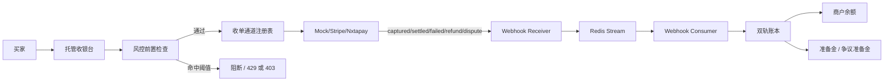
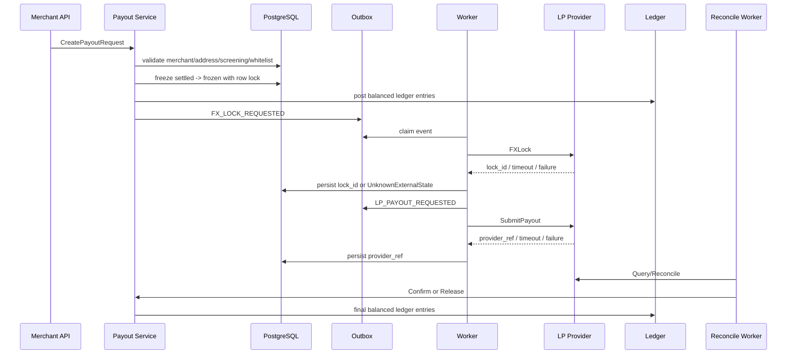
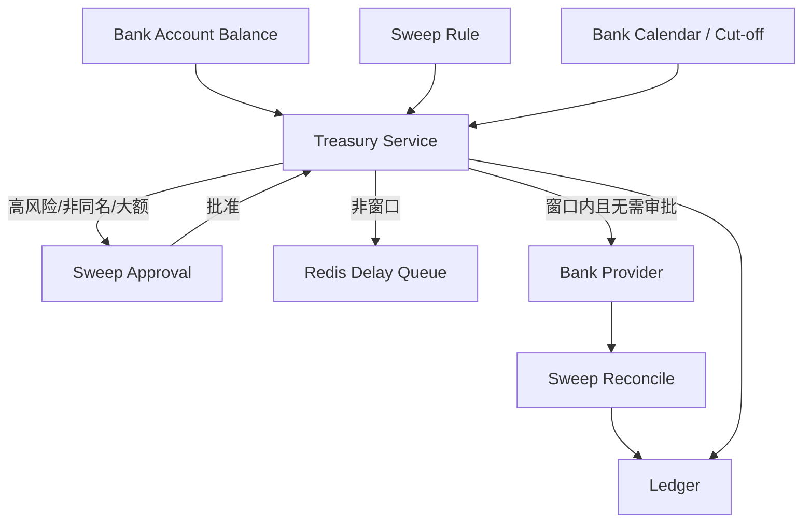
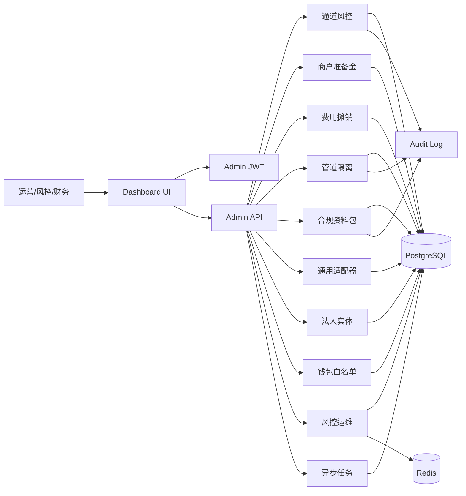
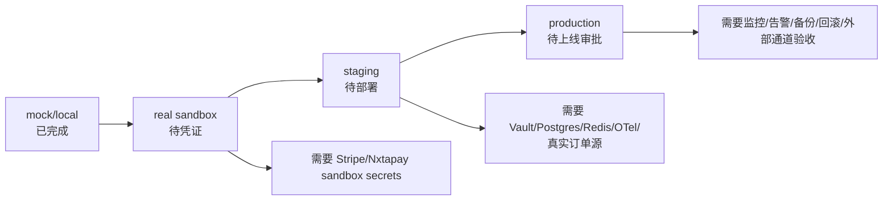

# NexusGlobal 全景拓扑图

生成日期：2026-06-15  
文档定位：系统功能、数据流、资金流、外部依赖和运维后台的全景拓扑。  
当前阶段：mock/local 预上线 100%；真实 sandbox 与 production 待独立验收。

---

## 1. 系统全景

```mermaid
flowchart TB
    User["买家 / Checkout 用户"]
    Merchant["商户系统 / 前线站点"]
    Admin["运营 / 风控 / 财务管理员"]

    CheckoutPage["托管收银台<br/>/checkout"]
    CheckoutAPI["Checkout API<br/>/api/checkout/*"]
    AdminDashboard["Admin Dashboard<br/>/admin/dashboard"]
    AdminAPI["Admin API<br/>/admin/*"]
    MerchantAPI["Merchant API<br/>/merchant/*"]
    InternalAPI["Internal API<br/>/internal/*"]
    WebhookAPI["Webhook Receiver<br/>/webhook/*"]

    Risk["Anti-Carding Gateway<br/>Redis Sliding Window"]
    AcquirerRegistry["Acquirer Channel Registry<br/>provider/channel/credential"]
    UniversalRegistry["Universal Adapter Registry<br/>CARD/BANK/CRYPTO/LP/EXCHANGE/WALLET"]
    CheckoutOrder["Checkout Order Provider<br/>mock/local, http/fail-closed"]

    Ledger["Double-entry Ledger"]
    Payout["Payout Service"]
    Treasury["Treasury / Sweep"]
    MAE["MAE Routing & Circuit Breaker"]
    Dispute["Dispute / Refund / Chargeback"]
    Reserve["Rolling Reserve"]
    Fee["Fee Allocation"]
    Pipeline["Pipeline Isolation"]
    RFI["Compliance RFI Documents"]
    Wallet["Wallet Policy"]
    Entity["Corporate Entity"]

    Outbox["Transactional Outbox"]
    Worker["Worker Runtime"]
    Streams["Redis Streams"]
    Consumers["LP / MAE / Bank Consumers"]
    DLQ["DLQ / Replay"]

    PG[("PostgreSQL<br/>source of truth")]
    Redis[("Redis<br/>cache/stream/lock/window")]
    Vault["Vault KMS<br/>real mode"]
    MockKMS["Mock KMS<br/>local only"]

    LP["LP Provider<br/>mock or real"]
    Bank["Bank Provider<br/>mock or real"]
    Stripe["Stripe Sandbox/Real<br/>pending external validation"]
    Nxtapay["Nxtapay Sandbox/Real<br/>pending external validation"]
    Exchange["Exchange / On-chain<br/>future real adapter"]

    User --> CheckoutPage --> CheckoutAPI
    Merchant --> CheckoutAPI
    Admin --> AdminDashboard --> AdminAPI
    Merchant --> MerchantAPI

    CheckoutAPI --> CheckoutOrder
    CheckoutAPI --> Risk
    CheckoutAPI --> AcquirerRegistry
    AcquirerRegistry --> Stripe
    AcquirerRegistry --> Nxtapay
    AcquirerRegistry --> PG

    AdminAPI --> UniversalRegistry
    AdminAPI --> Entity
    AdminAPI --> Wallet
    AdminAPI --> Pipeline
    AdminAPI --> RFI
    AdminAPI --> Reserve
    AdminAPI --> Fee
    AdminAPI --> PG

    MerchantAPI --> Payout
    InternalAPI --> Payout
    InternalAPI --> Treasury
    InternalAPI --> MAE
    InternalAPI --> Dispute

    Payout --> Ledger
    Treasury --> Ledger
    Dispute --> Ledger
    Reserve --> Ledger
    Fee --> Ledger
    Ledger --> PG

    Payout --> Outbox --> PG
    Treasury --> Outbox
    Worker --> Outbox
    Worker --> LP
    Worker --> Bank
    Worker --> Reserve
    Worker --> MAE

    WebhookAPI --> Streams --> Consumers --> Ledger
    Consumers --> DLQ
    DLQ --> Streams

    Risk --> Redis
    Streams --> Redis
    Worker --> Redis
    AdminDashboard --> AdminAPI

    AdminAPI --> Vault
    AdminAPI --> MockKMS
    AcquirerRegistry --> Vault
    AcquirerRegistry --> MockKMS
```



---

## 2. 资金主链路拓扑



说明：

- mock/local 已完成 success/failure/timeout 三态。
- real/production 禁止 raw PAN/CVV，必须使用 `payment_method_token`。
- 真实 Stripe/Nxtapay sandbox 仍待凭证联调。

---

## 3. Payout 出金拓扑



资金红线：

- 冻结必须先于外呼。
- DB transaction 内禁止外部网络 I/O。
- timeout 进入 UnknownExternalState，不按失败盲目释放。
- 对账必须有分布式锁。

---

## 4. Treasury / Sweep 拓扑



---

## 5. Dashboard 管理拓扑



Dashboard 当前能力：

- 点击 tab 自动加载对应真实 API。
- 危险操作确认。
- 空态、失败态中文提示。
- 不再要求运营“去数据库查询”。

---

## 6. Mock / Real 切换拓扑

```mermaid
flowchart TB
    Config["Environment Config"]

    AppEnv["APP_ENV<br/>local/staging/production"]
    ExternalMode["EXTERNAL_MODE<br/>mock/real"]
    AcquirerMode["ACQUIRER_MODE<br/>mock/real"]
    KMSMode["KMS_MODE<br/>mock/real"]
    CheckoutProvider["CHECKOUT_ORDER_PROVIDER<br/>mock/http/disabled"]

    MockLP["Mock LP"]
    RealLP["Real LP HTTP Client"]
    MockBank["Mock Bank"]
    RealBank["Real Bank HTTP Client"]
    MockMAE["Mock MAE"]
    RealMAE["Real MAE HTTP Client"]
    MockAcquirer["Mock Acquirer"]
    RealAcquirer["Stripe/Nxtapay Adapter"]
    MockKMS["Mock KMS"]
    RealKMS["Vault KMS"]
    MockOrder["Mock Order Provider"]
    HTTPOrder["HTTP Order Provider<br/>not implemented yet"]
    DisabledOrder["Checkout disabled"]

    Config --> AppEnv
    Config --> ExternalMode
    Config --> AcquirerMode
    Config --> KMSMode
    Config --> CheckoutProvider

    ExternalMode -->|mock| MockLP
    ExternalMode -->|real| RealLP
    ExternalMode -->|mock| MockBank
    ExternalMode -->|real| RealBank
    ExternalMode -->|mock| MockMAE
    ExternalMode -->|real| RealMAE

    AcquirerMode -->|mock| MockAcquirer
    AcquirerMode -->|real| RealAcquirer
    KMSMode -->|mock| MockKMS
    KMSMode -->|real| RealKMS

    CheckoutProvider -->|mock| MockOrder
    CheckoutProvider -->|http| HTTPOrder
    CheckoutProvider -->|disabled| DisabledOrder

    AppEnv -->|production forbids mock KMS/external/acquirer/order| Gate["Fail-closed startup validation"]
```



---

## 7. 外部验收边界



当前可以盖章的只有：

```text
mock/local 预上线级 100% 达成
```

不能盖章的仍是：

```text
真实 sandbox 100%
production 100%
```

