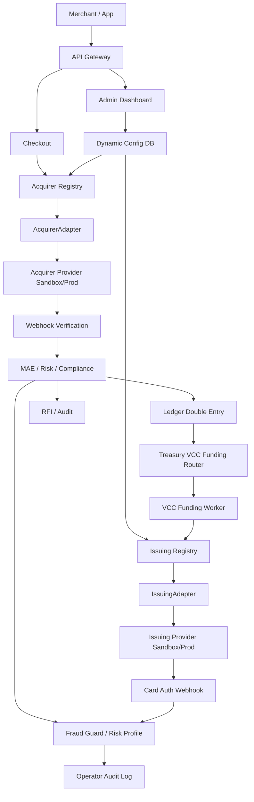

# NexusGlobal 3.0 全景拓扑图

生成时间：2026-06-16  
阶段：pre-production 100% 可验收，真实 sandbox 待凭证

## 一、系统全景 ASCII 拓扑

```text
┌──────────────────────────────────────────────────────────────────────────────┐
│                               NexusGlobal 3.0                               │
│                 Tier-Based Acquiring + Issuing + Treasury                    │
└──────────────────────────────────────────────────────────────────────────────┘

┌──────────────┐
│ Merchant/App │
└──────┬───────┘
       │ Checkout / API Request
       v
┌──────────────────────────────────────────────────────────────────────────────┐
│ API Gateway / cmd/api                                                       │
│ - Admin Auth / Merchant Auth / Internal Auth                                │
│ - Request ID / Recover / Health / Readiness                                 │
└──────┬───────────────────────────────────────────────────────────────────────┘
       │
       ├──────────────────────────────┐
       │                              │
       v                              v
┌──────────────────────┐      ┌────────────────────────────┐
│ Checkout Domain      │      │ Admin Dashboard / API       │
│ - order source       │      │ - visual config             │
│ - payment request    │      │ - risk / RFI / audit        │
│ - token-only real    │      │ - channel / issuing pools   │
└──────────┬───────────┘      └──────────────┬─────────────┘
           │                                 │
           v                                 v
┌──────────────────────────────────────────────────────────────────────────────┐
│ Dynamic Configuration Layer                                                  │
│ - acquirer_channels                                                          │
│ - issuing_providers                                                          │
│ - credential_vault_key                                                       │
│ - Redis Pub/Sub reload                                                       │
└──────────┬──────────────────────────────────────────────┬────────────────────┘
           │                                              │
           v                                              v
┌────────────────────────────┐                 ┌───────────────────────────────┐
│ Acquirer Registry          │                 │ Issuing Registry              │
│ - provider_tier            │                 │ - issuing_tier                │
│ - provider_code            │                 │ - funding_mode                │
│ - strategy_mode            │                 │ - pool_code                   │
└──────────┬─────────────────┘                 └──────────────┬────────────────┘
           │                                                  │
           v                                                  v
┌────────────────────────────┐                 ┌───────────────────────────────┐
│ AcquirerAdapter Interface  │                 │ IssuingAdapter Interface      │
│ - Authorize                │                 │ - CreateCard                  │
│ - Capture                  │                 │ - FreezeCard                  │
│ - Refund                   │                 │ - TerminateCard               │
│ - VerifyWebhook            │                 │ - ProcessAuthWebhook          │
└──────────┬─────────────────┘                 └──────────────┬────────────────┘
           │                                                  │
           v                                                  v
┌────────────────────────────┐                 ┌───────────────────────────────┐
│ Provider Sandbox/Prod      │                 │ VCC Provider Sandbox/Prod     │
│ - Stripe / Nxtapay / etc   │                 │ - Aggregator / Direct pools   │
│ - no hard-coded routing    │                 │ - no hard-coded routing       │
└──────────┬─────────────────┘                 └──────────────┬────────────────┘
           │                                                  │
           │ Webhook / Settlement                             │ Auth Webhook
           v                                                  v
┌──────────────────────────────────────────────────────────────────────────────┐
│ MAE / Risk / Compliance                                                      │
│ - transaction state machine                                                  │
│ - fraud guard / carding guard                                                │
│ - merchant risk profile                                                      │
│ - RFI documents                                                              │
│ - isolation groups                                                           │
│ - override audit logs                                                        │
└──────────┬──────────────────────────────────────────────┬────────────────────┘
           │                                              │
           v                                              v
┌────────────────────────────┐                 ┌───────────────────────────────┐
│ Ledger                     │                 │ Treasury / VCC Funding Router │
│ - double entry             │                 │ - high-risk fail-closed       │
│ - balances                 │                 │ - funding mode check          │
│ - idempotency              │                 │ - async worker job            │
│ - fee allocation           │                 │ - provenance retained         │
└──────────┬─────────────────┘                 └──────────────┬────────────────┘
           │                                                  │
           v                                                  v
┌────────────────────────────┐                 ┌───────────────────────────────┐
│ Payout / Reserve / FX Lock │                 │ VCC Available Balance         │
│ - freeze                   │                 │ - card spend authorization    │
│ - confirm                  │                 │ - decline sliding window      │
│ - release                  │                 │ - auto merchant issuing hold  │
│ - reconcile                │                 │ - audit                       │
└────────────────────────────┘                 └───────────────────────────────┘
```

## 二、双轨资金路径拓扑

```text
                         ┌─────────────────────────┐
                         │ Merchant Settled Balance│
                         └───────────┬─────────────┘
                                     │
                          provider_tier decision
                                     │
             ┌───────────────────────┴───────────────────────┐
             │                                               │
             v                                               v
┌────────────────────────────┐                  ┌────────────────────────────┐
│ TIER_2_COMPLIANT Acquiring │                  │ TIER_1_HIGH_RISK Acquiring │
│ compliant fiat rail        │                  │ restricted / review rail   │
└─────────────┬──────────────┘                  └─────────────┬──────────────┘
              │                                               │
              │ FIAT_DIRECT allowed if pool policy permits    │ FIAT_DIRECT blocked
              v                                               v
┌────────────────────────────┐                  ┌────────────────────────────┐
│ VCC Funding Router         │                  │ VCC Funding Router         │
│ route: fiat direct         │                  │ route: fail-closed         │
└─────────────┬──────────────┘                  └─────────────┬──────────────┘
              │                                               │
              v                                               v
┌────────────────────────────┐                  ┌────────────────────────────┐
│ Ledger Double Entry        │                  │ Manual/Async Review Flow   │
│ DR settled balance         │                  │ provenance retained        │
│ CR vcc available balance   │                  │ compliance isolation only  │
└─────────────┬──────────────┘                  └─────────────┬──────────────┘
              │                                               │
              v                                               v
┌────────────────────────────┐                  ┌────────────────────────────┐
│ Issuing Pool               │                  │ CRYPTO_DESENSITIZED Pool   │
│ funding_mode=FIAT_DIRECT   │                  │ funding_mode required      │
└────────────────────────────┘                  └────────────────────────────┘
```

说明：`CRYPTO_DESENSITIZED` 只表示合规隔离 funding mode，必须保留资金来源、审计链、审批链和状态链，不得用于隐藏来源或规避监管。

## 三、Admin API 拓扑

```text
Browser Dashboard
  |
  v
/admin
  |
  +-- /stats
  +-- /adapter/providers
  +-- /adapter/channels
  +-- /entities
  +-- /asset-bridge/profiles
  +-- /wallet-policies
  |
  +-- /v3/channel-risk
  +-- /v3/merchant-risk-profiles
  +-- /v3/rolling-reserves
  +-- /v3/fee-allocations
  +-- /v3/isolation-groups
  +-- /v3/rfi-documents
  +-- /v3/override-audit-logs
  |
  +-- /api/v3/channels
  |     +-- GET
  |     +-- POST
  |     +-- PATCH /{id}
  |     +-- POST /{id}/enable
  |     +-- POST /{id}/disable
  |     +-- POST /{id}/reload
  |
  +-- /api/v3/issuing/pools
        +-- GET
        +-- POST
        +-- PATCH /{id}
        +-- POST /{id}/enable
        +-- POST /{id}/disable
        +-- POST /{id}/reload
```

## 四、数据层拓扑

```text
PostgreSQL
  |
  +-- acquirer_channels
  |     +-- provider_tier
  |     +-- provider_code
  |     +-- channel_code
  |     +-- credential_vault_key
  |     +-- strategy_mode
  |     +-- provider_config
  |     +-- routing_config
  |
  +-- issuing_providers
  |     +-- issuing_tier
  |     +-- funding_mode
  |     +-- provider_code
  |     +-- pool_code
  |     +-- credential_vault_key
  |     +-- provider_config
  |     +-- velocity_config
  |
  +-- virtual_cards
  |     +-- merchant_id
  |     +-- provider_id
  |     +-- last4
  |     +-- status
  |     +-- declined_count_sliding_window
  |
  +-- ledger accounts / transactions / entries
  +-- merchant risk profiles
  +-- rolling reserves
  +-- fee allocations
  +-- isolation groups
  +-- rfi documents
  +-- override audit logs
  +-- transactional outbox
```

## 五、Worker 拓扑

```text
Transactional Outbox / Scheduled Jobs
  |
  +-- worker/outbox
  +-- worker/payout
  +-- worker/reconcile
  +-- worker/reserve_release
  +-- worker/fxlock
  +-- worker/vcc_funding
```

worker 共性要求：

- 幂等。
- 可重试。
- 错误可审计。
- 不产生半成品资金状态。
- production 关键路径 fail-closed。

## 六、外部依赖拓扑

```text
External Providers
  |
  +-- Acquirer providers
  |     +-- Stripe sandbox/prod
  |     +-- Nxtapay sandbox/prod
  |     +-- future providers through AcquirerAdapter
  |
  +-- Issuing providers
  |     +-- aggregator/direct pools
  |     +-- future providers through IssuingAdapter
  |
  +-- LP provider
  +-- Bank provider
  +-- MAE provider
  +-- Vault/KMS
  +-- Redis
  +-- PostgreSQL
```

## 七、Mermaid 全景图



